# Concept-LAB Mermaid Editor

> VS Code extension — `cl-mermaid-preview` v0.3.9

## Mermaid without the round trip

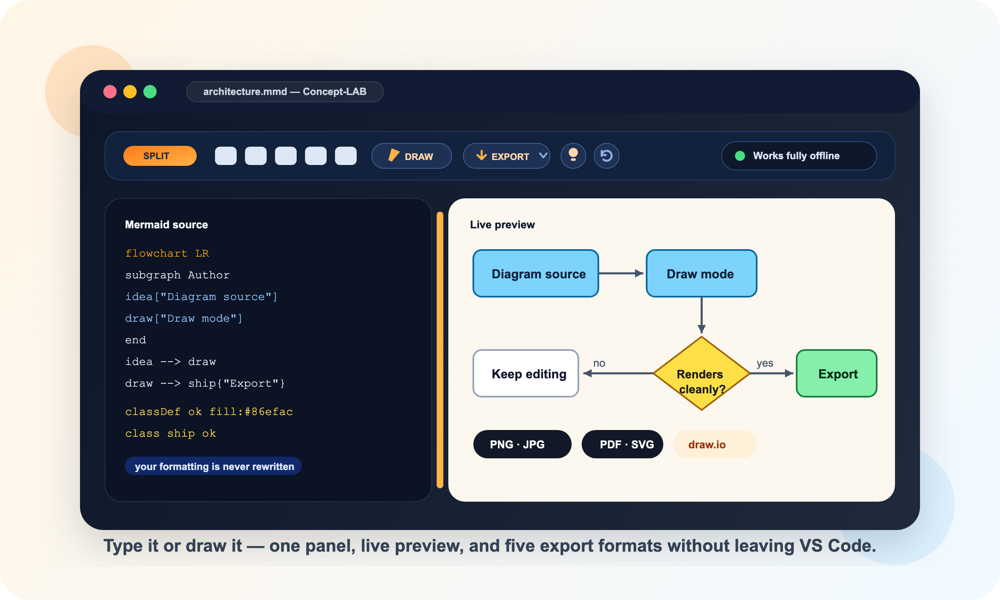

Concept-LAB turns a `.mmd` file into a real diagramming workspace inside VS Code: a code editor and a live SVG preview in one panel, a GUI you can draw in, and five export formats behind one button.

It is built for people who like Mermaid's plain-text source but are tired of the loop — edit, re-render somewhere else, screenshot, paste. Here the diagram is always on screen, always current, and one click away from a PNG, a PDF or an editable draw.io file.

Everything runs **offline**. Mermaid 11.16.1 and jsPDF are bundled with the extension; no CDN, no network call, no telemetry.

---

## Why teams use it

- Write Mermaid and see the rendered diagram immediately, as you type
- Or skip the syntax entirely and **build the flowchart by clicking in the preview**
- Start from 24 ready-made diagram templates instead of a blank file
- Ship the result as PNG, JPG, PDF, SVG — or as a **draw.io file with real editable shapes**
- Keep dark and light both readable, including the colours you defined yourself
- Stay in plain `.mmd` files that still work in every other Mermaid tool


The point is to remove the usual Mermaid trade-off: you should not have to choose between a text source you can diff, a GUI you can draw in, and an output you can hand to someone else. This extension does all three against the same file, and it never rewrites your source to do it — comments, ids, indentation and `%%{init}%%` blocks survive every GUI change.

---

## The user interface

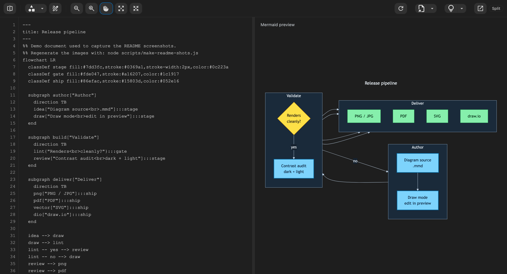

A real toolbar, a resizable split, and a preview that updates while you type. Every screenshot in this README is the actual shipped UI, captured from the extension's own webview.

### View modes

Click the toggle button at the top-left of the toolbar to cycle through three layouts. The mode you pick becomes the default for every `.mmd` you open afterwards — in any workspace, on any window, and it roams via VS Code Settings Sync.

| Screenshot | What you are seeing |
| --- | --- |
| 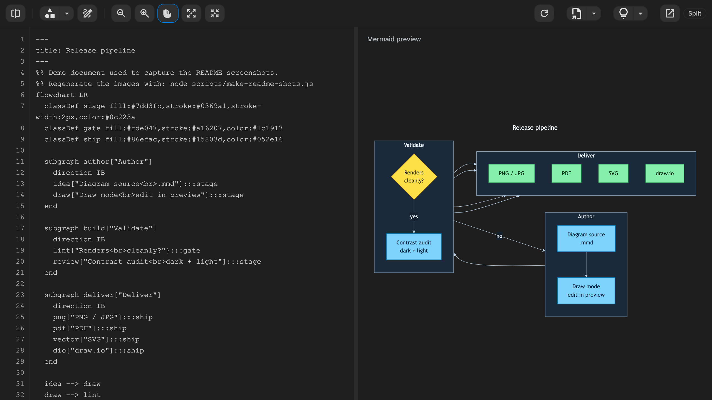 | **Split** keeps source and rendered diagram side by side. The divider between the two panes is draggable. This is the mode for authoring while continuously checking the result. |
| 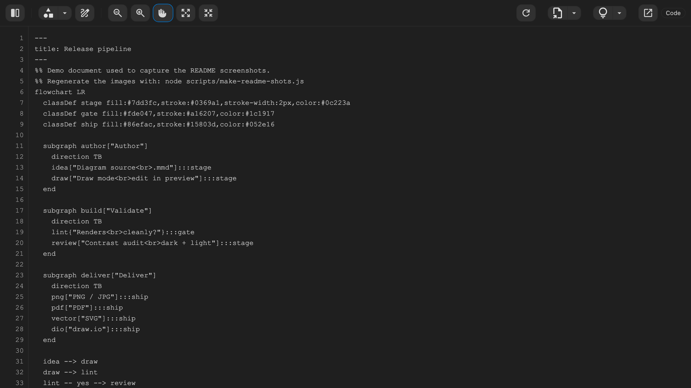 | **Editor** is the full-width code view, with wrap-aware line numbers and a syntax highlight overlay. Use it for focused syntax work. |
| 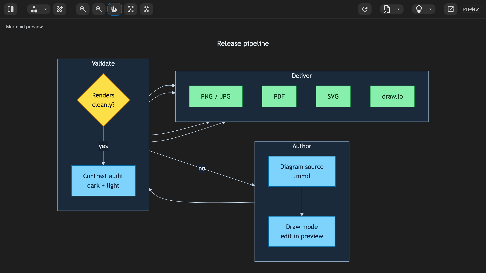 | **Preview** is the full-width diagram. The cleanest mode for reading, reviewing — and for drawing. |

### The toolbar

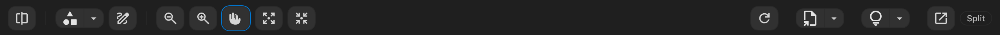

Left to right: view toggle · diagram templates · draw mode · zoom out · zoom in · pan · fit width · fit to screen — then, on the right, reload from disk · export · preview theme · open in the native text editor · the mode badge.

The toolbar is responsive. On a narrow panel the tools collapse **right to left** into a `⋯` burger menu, where they appear stacked with readable labels — the icons never squeeze or deform.

---

## Draw the diagram in the preview

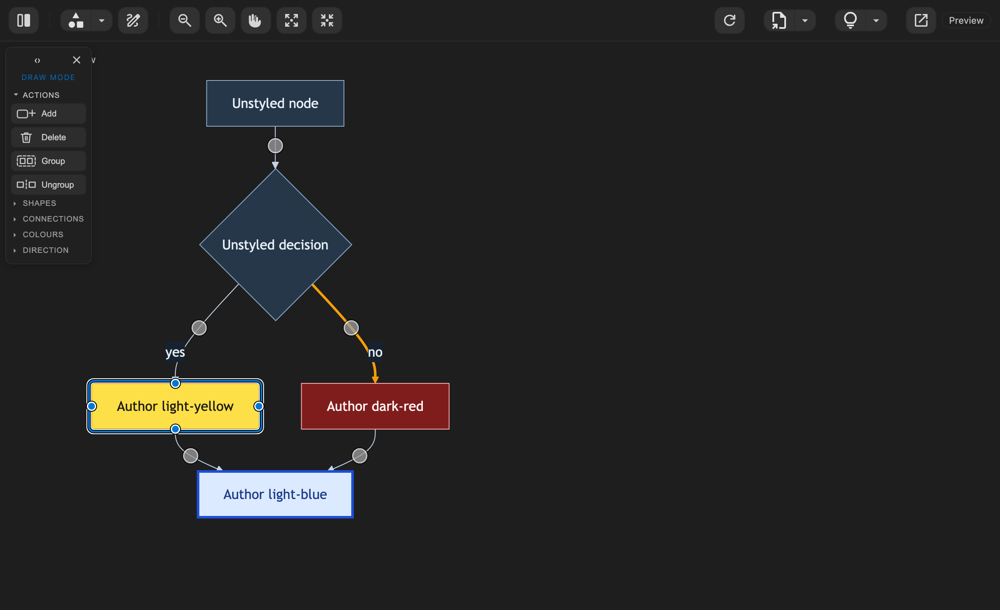

Switch to **draw mode** and the preview becomes editable. Click a node to select it, double-click to rename it, drag one of its anchor dots onto another node to connect them — or single-click an anchor to drop a connected sibling in that direction.

Two things make this different from a drawing canvas:

- **The layout stays Mermaid's.** Node positions are computed by the layout engine and reflow on every change; no coordinates are ever written into your file.
- **Edits are surgical.** Every action is a minimal splice into the source. Your comments, custom ids, indentation, `classDef`/`style` lines and `%%{init}%%` blocks are left byte-identical.

Selection rings and connection handles carry a white **and** a black stroke, so they stay clearly visible on any node fill — including a colour you defined yourself, in either theme.

> Draw mode works on **flowcharts**. Other diagram types render normally but are edited as text.

### Shapes, connections, colours

The drawing rail collapses into sections so it always fits the pane. Actions sit at the top, pickers below.

| Screenshot | What it does |
| --- | --- |
| 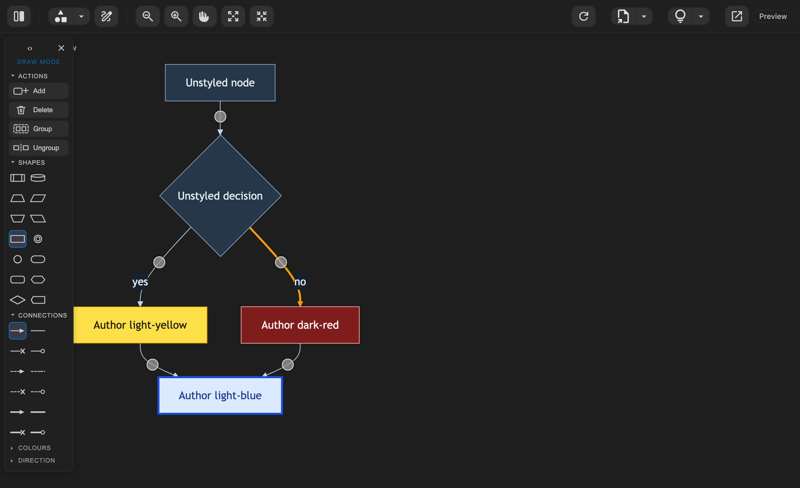 | **Shapes** offers all 14 flowchart shapes and **Connections** all 12 link types. Pick one and it applies to the next node or edge you create — or to whatever is selected. |
| 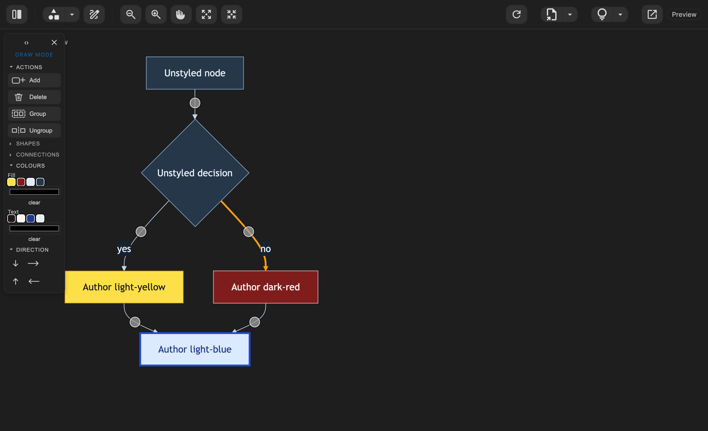 | **Colours** sets fill and text colour from the swatches already used in the diagram, or from the OS colour wheel. **Direction** switches the layout between TB, LR, BT and RL. |

Colour changes are merged into the node's existing `style` statement rather than appended as a second one, so nothing you declared earlier is silently dropped. Deleting a node also removes its `style` line and takes it out of any `class` list, so the GUI never leaves a dangling reference behind.

### Keyboard parity

| Key | Action |
| --- | --- |
| `Tab` / `Shift+Tab` | Cycle through nodes in document order |
| `Enter` | Rename the selected node |
| `Ctrl/Cmd+Enter` | Add a new connected node |
| `Delete` | Delete the selection (on a group: ungroup, keeping its nodes) |
| `Ctrl/Cmd+G` / `Ctrl/Cmd+Shift+G` | Group the marked nodes into a subgraph / ungroup |
| `Ctrl/Cmd+Z` | Undo the last GUI change |
| `Escape` | Clear the selection; press again to leave draw mode |

Shift-click marks several nodes at once, for grouping or for styling them together.

---

## Diagram templates

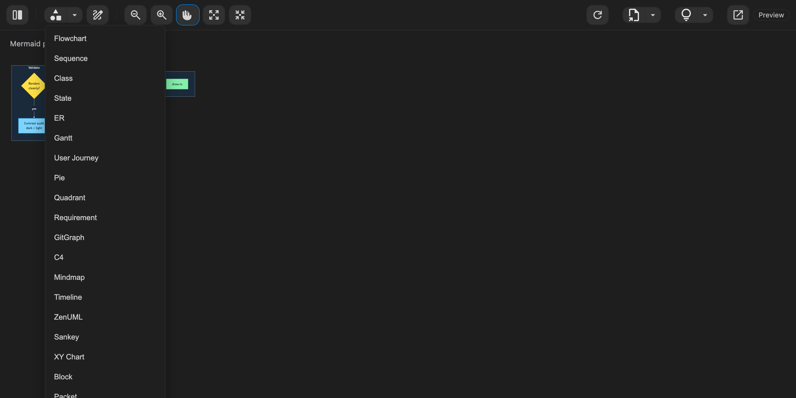

**24 starter templates**, one click each. If the file is empty the template replaces it; otherwise it is inserted at the cursor.

Flowchart · Sequence · Class · State · ER · Gantt · User Journey · Pie · Quadrant · Requirement · GitGraph · C4 · Mindmap · Timeline · ZenUML · Sankey · XY Chart · Block · Packet · Kanban · Architecture · Radar · Treemap · Venn

---

## Export

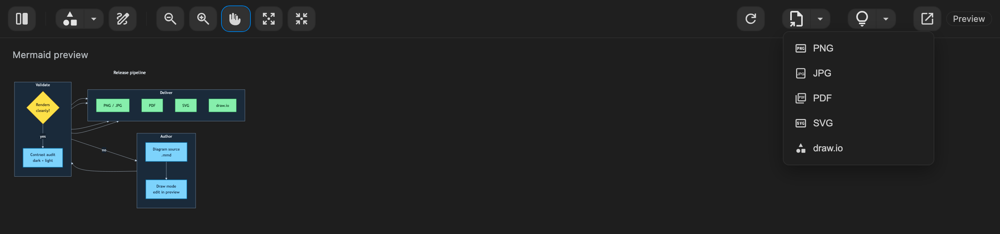

| Format | What you get |
| --- | --- |
| **PNG** | Rasterised at 2× minimum resolution |
| **JPG** | 92 % quality, on the active light/dark preview background |
| **PDF** | A4, automatic landscape for wide diagrams, centred with 24 pt margins |
| **SVG** | Vector, with explicit light/dark styles embedded so it renders standalone |
| **draw.io** | An `.drawio` file of **real editable shapes**, not a picture |

The draw.io export is the interesting one: all 14 shapes and 12 link types map to built-in draw.io styles, so the file opens without installing any shape library. Subgraphs become real containers, nesting included, and **Mermaid's own layout is preserved** — geometry is read from the rendered diagram, so what opens in diagrams.net matches what you saw in the preview. Author colours ride along.

A native VS Code save dialog opens for every format, defaulting to the `.mmd` filename with the matching extension.

---

## Dark and light

The preview follows your VS Code theme by default, and the lightbulb button in the toolbar forces **Auto**, **Light** or **Dark** when you need the other one — for example to check what a diagram will look like in a printed PDF.

| Dark | Light |
| --- | --- |
| 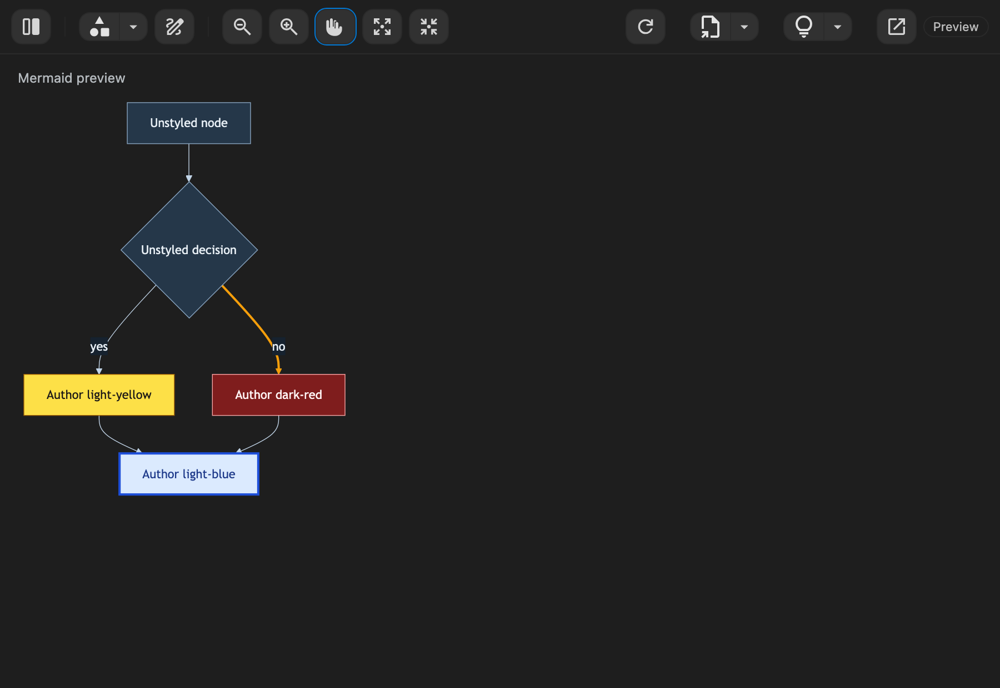 | 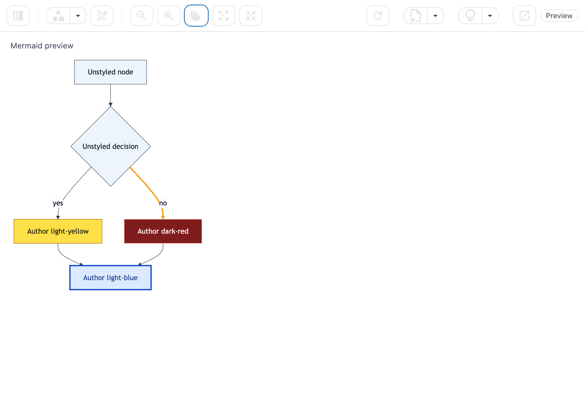 |

The same diagram, the same author-defined colours, in both themes. Theming is applied through Mermaid's own theme variables rather than by overriding colours afterwards, so a fill you set with `style` or `classDef` is never repainted. A separate safety net measures real contrast on the rendered diagram and repairs only demonstrated collisions — text that would be invisible against its own container, or a connector that would vanish into the page.

Exports use the same palette as the preview, so what you see is what you send.

---

## Zoom, pan and fit

| Control | Action |
| --- | --- |
| **Mouse wheel / trackpad** | Stepless zoom, no modifier needed — the point under the cursor stays put |
| **Zoom in / Zoom out** | One step per click, 20 % to 5000 % |
| **Pan** | Hand-tool drag mode (enabled by default) |
| **Fit width** | Scale the diagram to fill the pane width |
| **Fit to screen** | Scale and centre the whole diagram, width *and* height |

---

## Find and replace

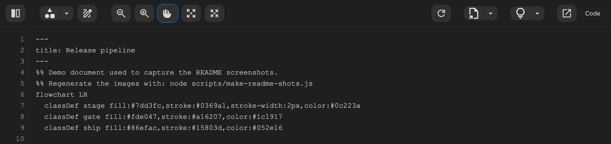

Open the find bar with `Ctrl+F` while the editor pane has focus. `Ctrl+H` (or the `»` chevron) expands the replace row.

| Control | Shortcut |
| --- | --- |
| Open find | `Ctrl+F` |
| Next / previous match | `Enter` / `Shift+Enter` |
| Match case | `Alt+C` |
| Whole word | `Alt+W` |
| Regular expression | `Alt+R` |
| Replace current | `Enter` in the replace row |
| Replace all | `Ctrl+Alt+Enter` |
| Close | `Esc` |

---

## Install

### Install the VSIX

This repository ships the packaged extension at the root:

- `concept-lab-vsc-mermaid-editor.vsix`

In VS Code:

1. Open the Extensions view (`Ctrl+Shift+X`)
2. Click `···` → **Install from VSIX…**
3. Select `concept-lab-vsc-mermaid-editor.vsix`
4. Reload the window

Or from the command line:

```bash
code --install-extension ./concept-lab-vsc-mermaid-editor.vsix
```

To rebuild it yourself:

```bash
npm install
npm run package
```

### Set as default editor for .mmd files

Add this to your **User** `settings.json`:

```json
{
  "workbench.editorAssociations": {
    "*.mmd": "conceptLabMermaidPreview.editor"
  }
}
```

---

## What you get

### Editing and layout

- Three view modes — Split, Editor, Preview — with the choice remembered globally
- Resizable split pane
- Responsive toolbar that collapses right-to-left into a burger menu
- Syntax highlight overlay and wrap-aware line numbers
- Reload-from-disk button, for files changed by external tools or AI agents
- Open the same file in VS Code's native text editor at any time

### Diagramming

- Live Mermaid rendering with inline syntax-error display
- GUI drawing for flowcharts: node and edge CRUD, 14 shapes, 12 link types, edge labels, subgraph grouping, layout direction, node colours
- A dedicated GUI undo stack
- 24 diagram templates

### Output

- PNG, JPG, PDF, SVG and draw.io export through a native save dialog
- Auto / Light / Dark preview themes, with author-defined colours preserved
- Exports rendered from the same palette as the preview

### Trust

- Fully offline — Mermaid 11.16.1 and jsPDF are vendored into the extension
- No network access, no CDN, no telemetry
- Your `.mmd` stays a plain, portable Mermaid file

---

## Requirements

- VS Code `^1.83.0`
- Node.js and npm — for building only

---

## Licence

Copyright © 2026 **Concept-LAB BV**. All rights reserved.

This is proprietary software, licensed and not sold. See [LICENSE.txt](LICENSE.txt) for the full terms. The bundled open-source components keep their own licences, listed in [THIRD-PARTY-NOTICES.md](THIRD-PARTY-NOTICES.md).

---

## Development

```bash
npm install
npm run compile      # TypeScript sanity check
npm test             # compile + guardrail suite
npm run package      # builds concept-lab-vsc-mermaid-editor.vsix
npm run watch        # compile in watch mode
```

Press **F5** in VS Code to launch an Extension Development Host with the extension loaded.

The extension host and the whole webview live in `src/extension.ts`; compiled output goes to `dist/extension.js`. Pure, testable webview logic lives in `media/webview/` (`mmd-model.js`, `drawio-export.js`), and vendored libraries plus icons live under `media/`.

Additional test suites:

```bash
npm run test:drawing   # drives the real webview in headless Chrome
node scripts/test-model.js
node scripts/test-drawio.js
```

### Regenerating the README assets

Every interface image in this README is captured from the real webview — the same template literal that ships in `src/extension.ts`, rendered in headless Chrome with the real icon set:

```bash
npm run readme:shots                               # all screenshots + teasers
node scripts/make-readme-shots.js draw-mode-rail   # just one
npm run readme:pdf                                 # README.md -> README.pdf
```

Output lands in [docs/readme-assets/](docs/readme-assets/). The demo diagram is [showcase.mmd](docs/readme-assets/showcase.mmd); the two commercial teasers are hand-authored SVGs in the same folder and are rendered to PNG by the same script. `readme:pdf` writes [README.pdf](README.pdf) next to this file. Both scripts skip with exit code 0 when no Chrome, Chromium or Edge is installed.
